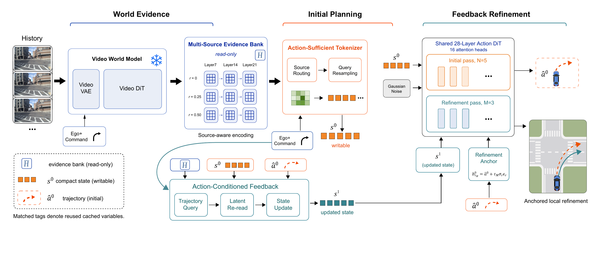

<h1 align="center">BALI-Drive</h1>

<p align="center">
  <strong>Bidirectional Action-Latent Interaction with Multi-Source Video World Model Evidence<br>
  for End-to-End Autonomous Driving</strong>
</p>

<p align="center">
  <a href="#overview">Overview</a> &nbsp;|&nbsp;
  <a href="#installation">Installation</a> &nbsp;|&nbsp;
  <a href="#usage">Usage</a> &nbsp;|&nbsp;
  <a href="docs/usage.md">API &amp; Configuration</a>
</p>

## Overview

**BALI-Drive couples scene understanding and motion planning through
bidirectional action-latent interaction.** A frozen video world model provides
multi-source evidence for a compact planning state. An initial trajectory then
queries that evidence to update the state and refine the plan with the same
action planner.

<p align="center">
  <a href="assets/method_overview.pdf">
    
  </a>
  <br>
  <a href="assets/method_overview.pdf">Method overview from the paper (vector PDF)</a>
</p>

- **Multi-source evidence:** retain hidden states from multiple video denoising
  stages and network layers, with spatial, temporal, and source identities.
- **Action-sufficient state:** use scene-conditioned routing and learnable
  queries to compress the evidence into 128 state tokens.
- **Action-conditioned feedback:** retrieve candidate-relevant evidence, apply
  a gated state update, and refine the trajectory without another video-model pass.

The default planner is a shared **28-layer, 16-head Action DiT**, with five
initial-generation steps and three local-refinement steps. See
[configuration defaults](docs/usage.md#configuration) for the complete settings.

## Installation

Use Python 3.10 or later. From the repository root, install into the environment
used by your action backbone:

```bash
python -m pip install -e .
```

Package dependencies are specified in [`pyproject.toml`](pyproject.toml).
Backbone initialization and video-feature extraction are supplied by the caller.

## Usage

The following functions show model construction and trajectory sampling.
`action_expert` is an initialized compatible backbone object, and `preprocess`
is its `preprocessing_action_states` callable. Load trained BALI-Drive parameters
into the constructed model before using it for planning.

```python
from bali_drive import ActionDiT, BaliDrive, ModelConfig
from bali_drive.flow import denormalize_actions


def build_model(action_expert, preprocess):
    cfg = ModelConfig()
    planner = ActionDiT(action_expert, cfg, preprocess)
    return BaliDrive(cfg, planner)


def plan(model, raw_bank, ego, command, generator=None):
    model.eval()
    output = model.sample(raw_bank, ego, command, generator=generator)
    return {
        name: denormalize_actions(output[name], model.cfg)
        for name in ("initial", "refined")
    }
```

`raw_bank` contains scene-aligned video features; `ego` and `command` contain
ego-state and navigation conditions. `plan` returns initial and refined
trajectories of shape `[B, 8, 3]` by default, in **metres and radians**. Inputs and
parameters must use compatible devices and floating-point dtypes.

See the [usage guide](docs/usage.md) for input conventions, normalization,
loss interfaces, sampling controls, and the source-code map.

## Acknowledgments

The action-expert adapter is compatible with
[DriveLaW-Act (2026)](https://github.com/xiaomi-research/drivelaw).
External components retain their original attribution and usage terms; see
[`NOTICE.md`](NOTICE.md).
